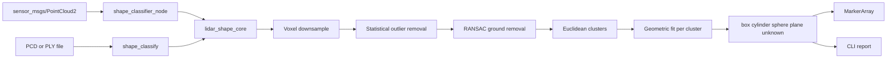

# LiDAR shape classifier

Geometric shape labels for LiDAR-style point clouds. A small C++17 library filters a cloud, removes the ground plane, splits the rest into Euclidean clusters, and labels each cluster as **box**, **cylinder**, **sphere**, **plane**, or **unknown**. A ROS 2 Humble node publishes those labels as a `visualization_msgs/MarkerArray`. The same pipeline runs from a file through a standalone CLI.

This is a portfolio demo, not production code. Arpan Bom ([applycoding](https://github.com/applycoding)) worked on 3D shape classification for LiDAR on a humanoid robot at Vision One. This repository is an independent, self-contained demo of that kind of pipeline. It does not include proprietary models, data, or the robot stack.

## What it does

1. Drop non-finite points.
2. Voxel downsample (`pcl::VoxelGrid`).
3. Remove statistical outliers.
4. Remove a near-horizontal ground plane with RANSAC (`SACMODEL_PERPENDICULAR_PLANE`).
5. Euclidean clustering.
6. Label each cluster from geometric fits:
   - **Plane**: PCA thickness plus a RANSAC plane inlier ratio.
   - **Sphere**: eigenvalue ratios, radial consistency, and a RANSAC sphere.
   - **Box**: fraction of points on the six faces of the PCA oriented box.
   - **Cylinder**: radius consistency about a PCA axis, with a round cross-section.
   - **Unknown**: none of the checks pass.

RANSAC uses PCL's fixed default seed, so the same cloud produces the same plane and sphere fits.

## Architecture

The core library links PCL and Eigen and has no ROS dependency. The node and the CLI both call `lsc::run_pipeline`.



```
include/lidar_shape_classifier/   public headers (Eigen only)
src/                              core, CLI, scene generator
src/ros/shape_classifier_node.cpp ROS 2 wrapper
config/classifier.yaml            node parameters
launch/classifier.launch.py       Humble launch file
test/test_core.cpp                GoogleTest for the core
```

## Build the core

Ubuntu 22.04 or 24.04:

```bash
sudo apt-get update
sudo apt-get install -y build-essential cmake libpcl-dev libeigen3-dev libgtest-dev libopenmpi-dev
cmake -S . -B build -DCMAKE_BUILD_TYPE=Release -DBUILD_ROS_NODE=OFF
cmake --build build -j"$(nproc)"
ctest --test-dir build --output-on-failure
```

Generate a sample scene and label it:

```bash
./build/generate_scene --output /tmp/scene.pcd
./build/shape_classify --input /tmp/scene.pcd
```

`generate_scene` also writes PLY when the path ends in `.ply`. `shape_classify --help` lists the filter flags. Defaults match the synthetic room: a 3 cm voxel, a horizontal ground band of 8 cm, and a 10 cm cluster tolerance.

The generated room contains a ground plane, one box, one vertical cylinder, one sphere, one vertical wall, and a few distant outliers. After a successful run the CLI reports four clusters: box, cylinder, sphere, and plane. The ground points are removed before clustering.

## ROS 2 Humble

Source a Humble environment, then build with colcon from this directory:

```bash
source /opt/ros/humble/setup.bash
sudo apt-get install -y \
  ros-humble-rclcpp \
  ros-humble-sensor-msgs \
  ros-humble-visualization-msgs \
  ros-humble-pcl-conversions \
  libpcl-dev \
  libeigen3-dev
colcon build --packages-select lidar_shape_classifier --cmake-args -DCMAKE_BUILD_TYPE=Release
source install/setup.bash
ros2 launch lidar_shape_classifier classifier.launch.py
```

| Topic | Type | Direction |
| --- | --- | --- |
| `/points` | `sensor_msgs/PointCloud2` | subscribe |
| `/shape_markers` | `visualization_msgs/MarkerArray` | publish |
| `/shape_non_ground` | `sensor_msgs/PointCloud2` | publish |

Marker colors: box orange, cylinder blue, sphere green, plane yellow, unknown gray. A text marker repeats the class name. In RViz, add a MarkerArray display on `/shape_markers` and a PointCloud2 display on `/points`.

Parameters live in `config/classifier.yaml` and match `lsc::PipelineConfig`. The launch file names the node `shape_classifier`, which is the key in that file. An empty cloud frame id falls back to the `frame_id` parameter (`lidar`).

## Jetson and Raspberry Pi

**Jetson (JetPack 6, Ubuntu 22.04).** Install the same apt packages as the desktop build, including `libopenmpi-dev` if CMake stops while configuring PCL's VTK dependency. Humble is the matching ROS 2 distro when you want the node. Configure with `-DCMAKE_BUILD_TYPE=Release`. A voxel leaf of 3 to 5 cm keeps the node responsive on an Orin Nano. If the link step runs out of memory, build with `-j2`.

**Raspberry Pi.** Use a 64-bit Raspberry Pi OS or Ubuntu 22.04/24.04 image and the same apt packages for the CLI. A Pi 4 with 4 GB of RAM should have about 2 GB of swap before compiling against PCL. The CLI does not need ROS. The Humble node wants Ubuntu 22.04. Release builds and a 5 cm voxel leaf are the practical settings on a Pi 4.

## Tests and CI

GoogleTest covers downsampling, outlier removal, ground removal, clustering, each shape class, a PCD/PLY round trip, and the full synthetic room. GitHub Actions on Ubuntu 22.04 builds the core and runs those tests. A second job builds the Humble node with `ros-tooling/setup-ros` and does not repeat the test binary.

## Limits

The labels are geometric heuristics with fixed thresholds in `src/classify.cpp`. The demo expects a dominant horizontal ground plane and objects separated by more than the cluster tolerance. Partial scans, heavy clutter, and shapes outside the five labels come back as unknown. There is no tracker, no learned model, and the pipeline is single-threaded.

## License

MIT. See [LICENSE](LICENSE).
